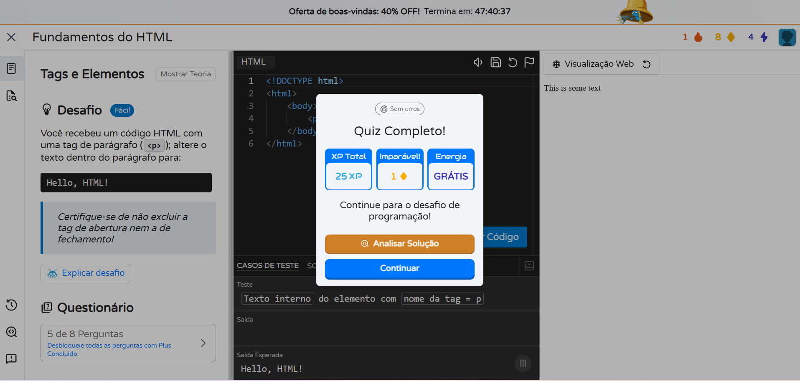
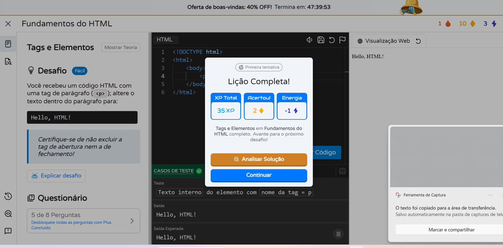
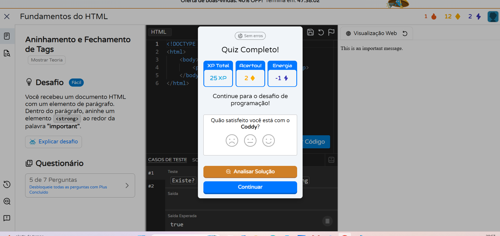
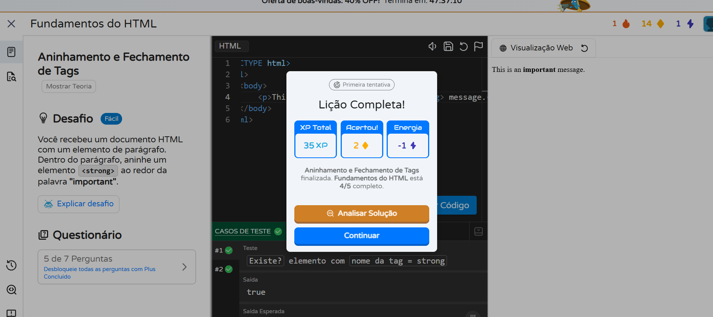
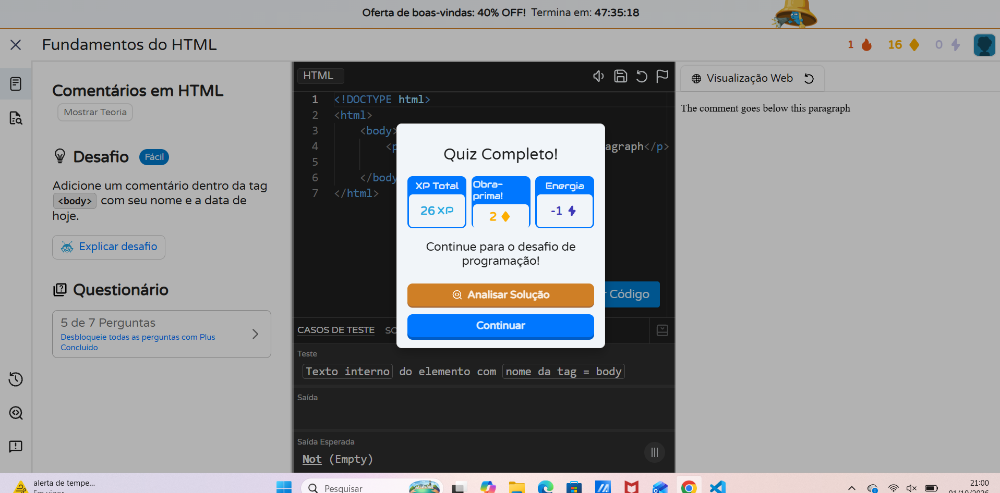
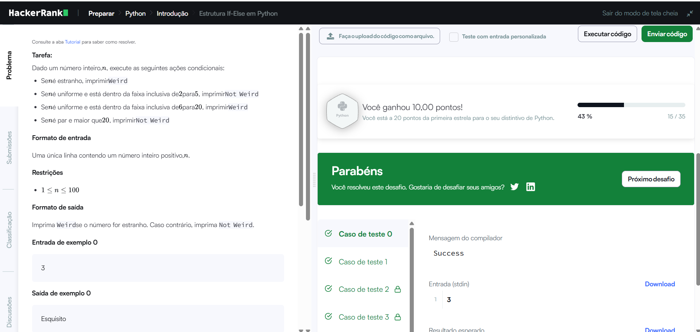
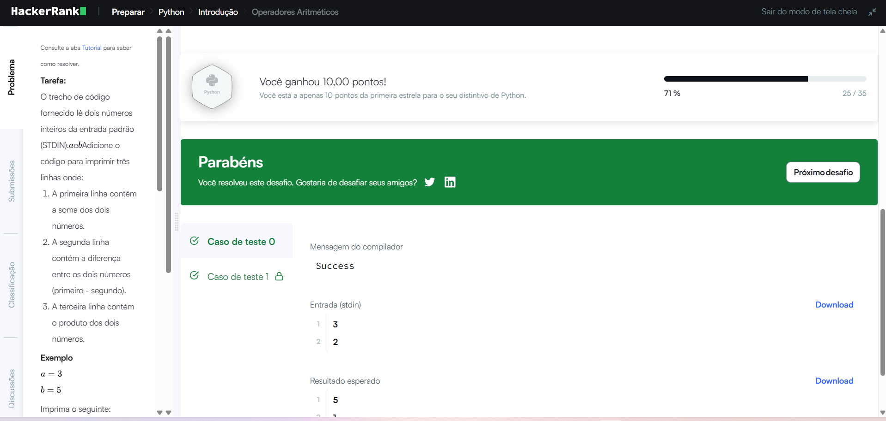
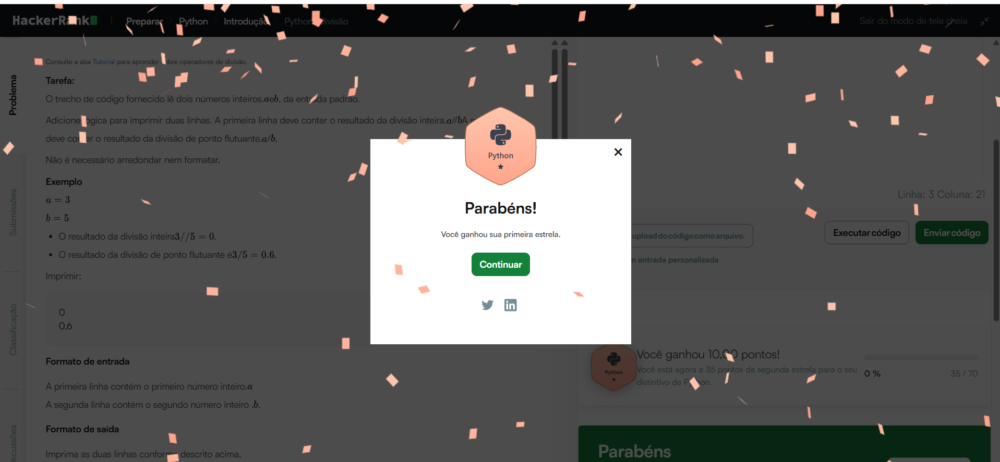
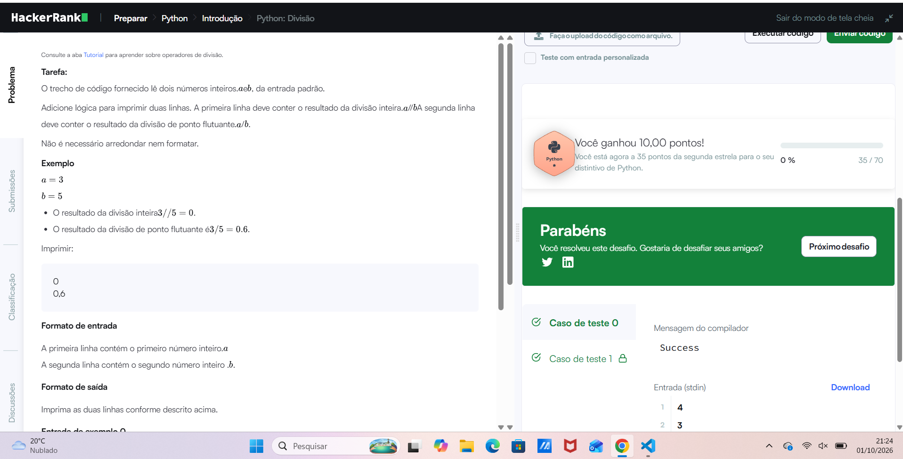
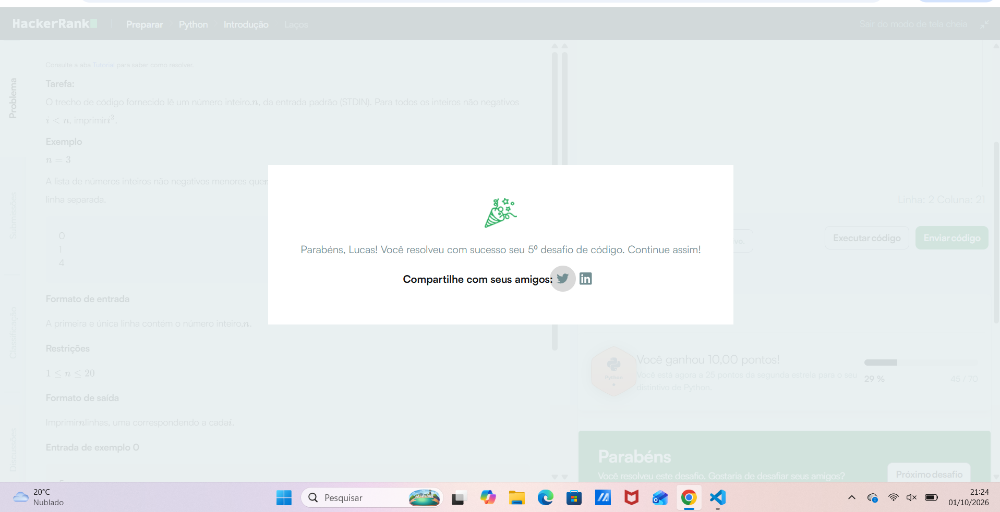

## IMAGENS REFERENTE A CODDY e 

# Resolução de Desafios Práticos
**Estudante:** Lucas aparecido de Souza cardoso
**Plataforma Utilizada:** Coddy ,
HackerRank
**Tecnologia Praticada:** HTML e PYTHON
**Disciplina:** Design Profissional 1 semestre
---
## Tabela de Exercícios e Comprovações

#  01  coddy atividade

Na plataforma Coddy, pratiquei os conceitos fundamentais do desenvolvimento Web com HTML. Comecei por estruturar a base essencial de um documento através das tags , e . Em seguida, aprendi a manipular o conteúdo visual das páginas alterando textos dentro dos elementos do parágrafo e aplicando destaques semânticos com a tag aninhada no texto. Também explorei a documentação de código ao inserir comentários HTML() no corpo da página. Por fim, consolidei a minha aprendizagem respondendo a questionários teóricos (quizzes) que testaram a minha compreensão sobre a sintaxe, abertura e fechos corretos das tags antes da execução prática.

#  02 HackerRank atividade
Na plataforma HackerRank, pratiquei uma lógica de programação e resolução de problemas em Python. Comece a aplicar o controle de fluxo condicional conforme as instruções if, elif e else, utilizando o módulo do operador (%) para verificar a paridade de números inteiros. Em seguida, trabalhei com operações aritméticas fundamentais para realizar operações de soma (+), subtração (-) e multiplicação (*). Por fim, explorei a distinção entre a divisão inteira (//) e a divisão de ponto flutuante (/), consolidando meu conhecimento sobre os tipos de dados numéricos em Python.

---
## Resumo dos Conceitos Praticados
Nesta experiência de aprendizagem com HTML no Coddy e Python no HackerRank, consolidei conceitos fundamentais de desenvolvimento web e lógica de programação. Em HTML, utilizei frequentemente tags de estrutura e formatação como html, body, p e strong, além de comentários para organizar o código. Em Python, as estruturas mais exploradas foram os condicionais if/elif/else, aplicados no controlo de fluxo, e os operadores aritméticos de soma, subtração, multiplicação e divisão.

As principais dificuldades surgiram na adaptação à sintaxe rigorosa de cada linguagem, como o fecho correto de tags aninhadas em HTML e o manuseio das diferentes divisões em Python (// e /). Um obstáculo inesperado ocorreu no HackerRank devido à tradução automática do navegador, que alterava palavras reservadas como if para se e gerava erros de compilação, exigindo atenção acrescida para manter o ambiente de desenvolvimento na linguagem original.